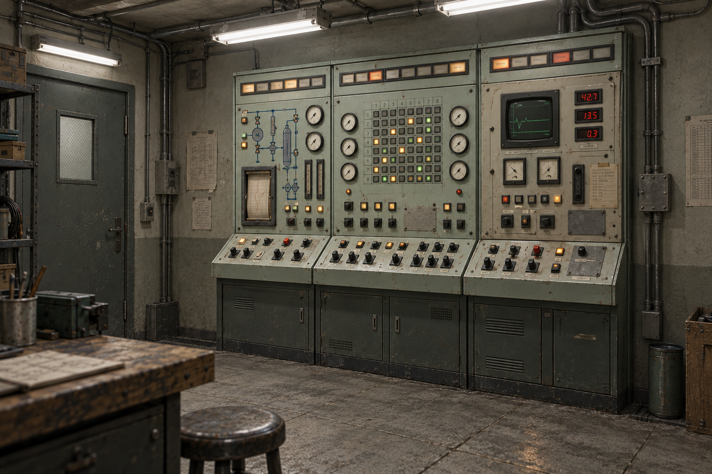
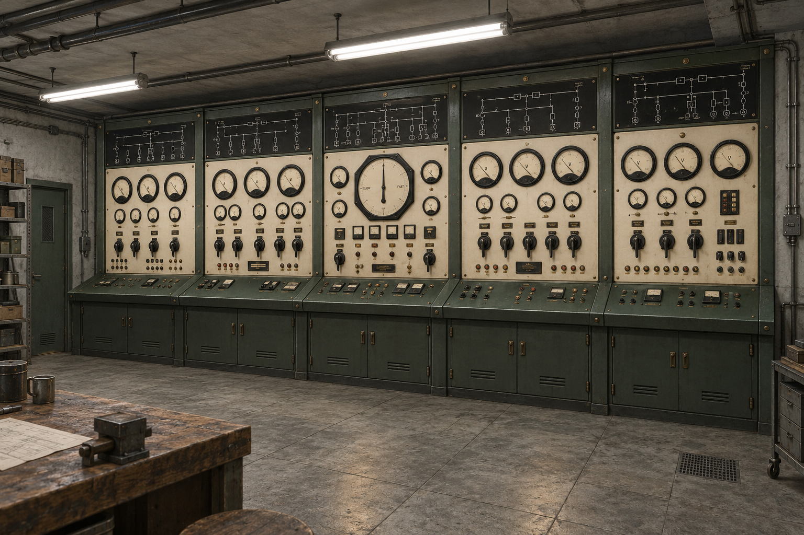
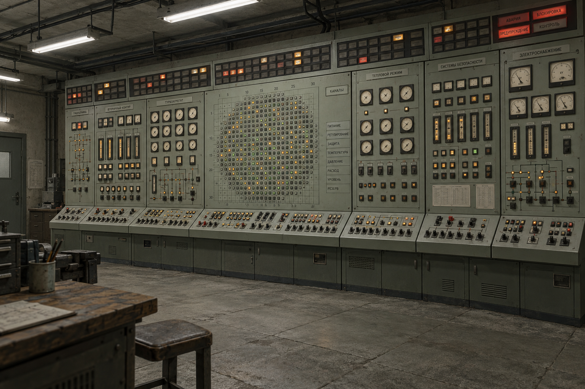
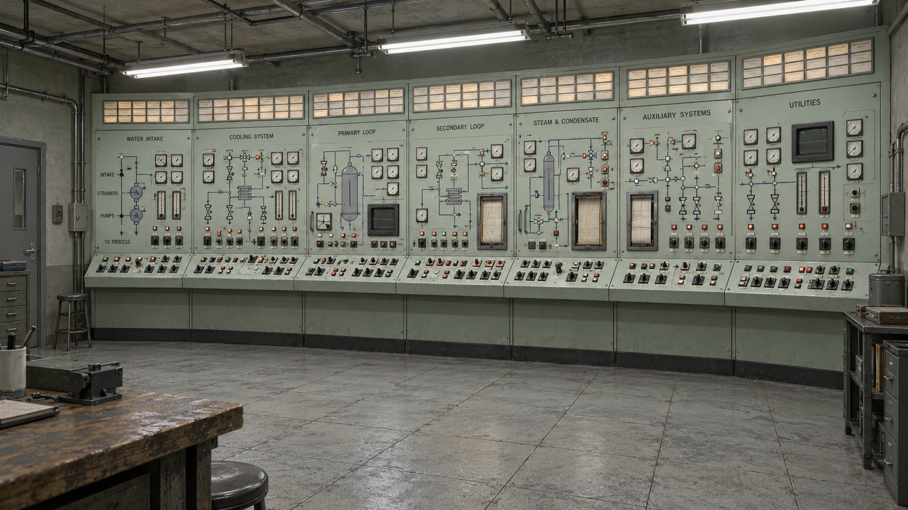

# East-wall control panel concepts

Environment concepts for an industrial control installation on the east wall opposite the west workbench. Generated with the built-in imagegen tool on 2026-10-12. These are visual pitches rather than exact historical reconstructions or an implementation. The first three explore visual styles; concept 04 supersedes their scale following the owner's small-room constraint and combines the preferred directions 02 and 03.

## 4. Compact hybrid — current direction

Three narrow bays combine 02's central channel grid and instrument density with 03's mint enamel, blue process diagrams and chart recorder. The right bay is a visibly mismatched 1980s retrofit with a small CRT, red numeric displays, square instruments and bolted adapter plates. Dust, faded paper and chipped paint reflect abandonment in the 1990s.

The existing scene defines a room 4.5 m wide by 5 m deep and 2.7 m high. Proposed panel dimensions are approximately 2.25 m wide, 2.1 m high and 0.4 m deep, including a shallow control ledge; these are design targets to verify against scene geometry, not measured from the illustration. The artwork was checked for three bays, exposed wall margins, mixed hardware generations and the workbench-opposite composition.

Reserve the east-wall panel area by relocating the filing cabinet and phone if needed. A possible arrangement is a phone near the entrance and filing storage on a free south-wall section, subject to door-swing and tool-board clearance. No objects have been moved in the simulator.

The large preliminary hybrid was superseded before saving to the project; the compact version is the delivered refinement.

## 1. The Grand Switchboard

Battersea-inspired cream enamel, dark steel framing, black mimic-diagram headers, large analogue meters and an oversized central synchroscope. The repeated bays give the wall an architectural rhythm. This direction has the strongest connection to the existing VX3 valve-era equipment and the clearest silhouettes for a PS1-style implementation.

## 2. The Channel Wall

Chernobyl-inspired grey-green panels with a commanding central channel-map grid, tightly grouped gauges, vertical indicators and a continuous alarm-window crown. The shallow console keeps the room navigable while the dense upper panels make the installation feel much larger than the bench. My recommended direction for the requested vast Soviet industrial atmosphere.

## 3. The Process Gallery

Fukushima-inspired pale mint panels organised around interconnected process diagrams, repeated pump and valve controls, paper chart recorders and a few small CRTs. This is the brightest and most legible option, with clear differences between adjacent system bays.

## Suggested combination

Use the Channel Wall's overall massing and central indicator grid, the Grand Switchboard's large black-bezel instruments and tactile Bakelite handles, and the Process Gallery's system diagrams. Give the installation a top alarm band, a middle instrument band, a waist-height sloping control ledge and a solid service-door plinth. For the game, retain those large forms and simplify tiny labels and repeated hardware.

## Research references

[Battersea Power Station's restoration account](https://batterseapowerstation.co.uk/news/battersea-power-station-unveils-newly-restored-control-room-a/) documents the original switchboard banks, large synchroscopes and semicircular control desk. Battersea was a coal-fired station; it is included as the user's analogue industrial reference.

[TEPCO's official Fukushima control-room photo library](https://photo.tepco.co.jp/en/date/2011/201103-e/110323-01e.html) provides a primary photographic reference for the broad panel banks. [TEPCO's 360-degree control-room tour](https://www.tepco.co.jp/sp/insidefukushimadaiichi/tour/guide13/mcr_index-j.html) provides additional spatial context. These show post-accident conditions, so the concepts borrow hardware and layout rather than damage or emergency staging.

[Photographer's Chernobyl operator-station detail album](https://imgur.com/gallery/operator-station-details-inside-chernobyl-reactor-control-rooms-oc-8u3mbz3) provides close views of instrument grouping and labels. This is a visual reference rather than an engineering specification.

[IAEA control-room human–machine interface guidance](https://www-pub.iaea.org/MTCD/Publications/PDF/PUB1843_Web.pdf) identifies analogue meters, light indicators, numeric readouts and plotters among display devices. The proposed visual grouping is an artistic interpretation, not a nuclear control-system design.

## Generation prompts

The exact prompts are recorded in [prompts.md](prompts.md). All three images were reviewed for wall-scale composition, analogue hardware, distinct design direction and the workbench-opposite viewpoint. Fine instrument text is illustrative; it should be authored separately if implemented.
