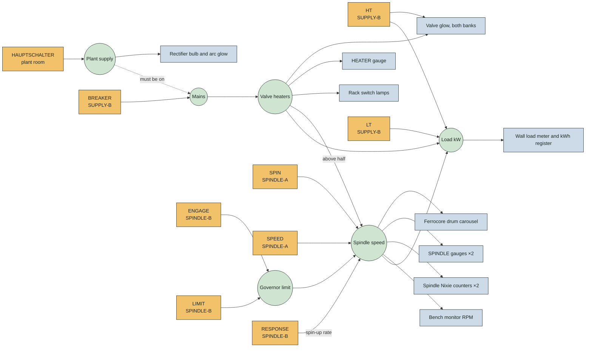
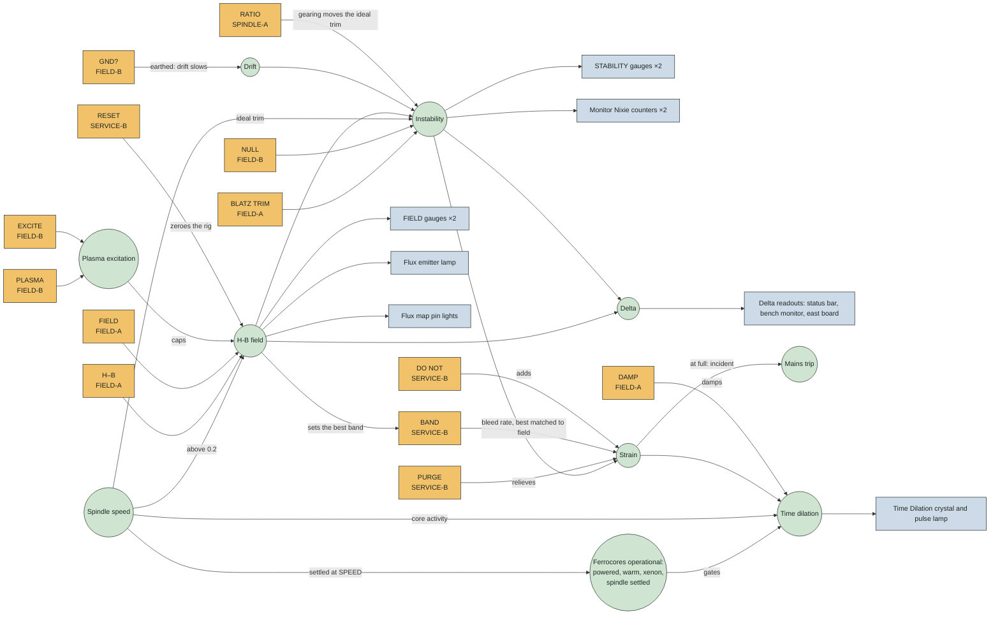
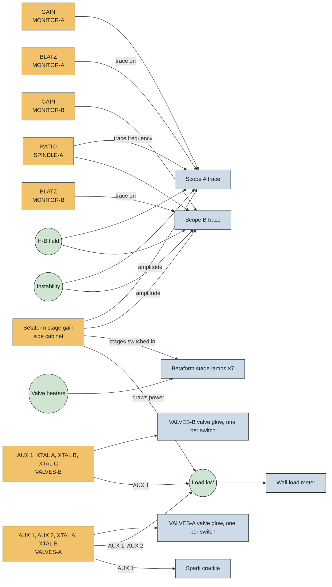
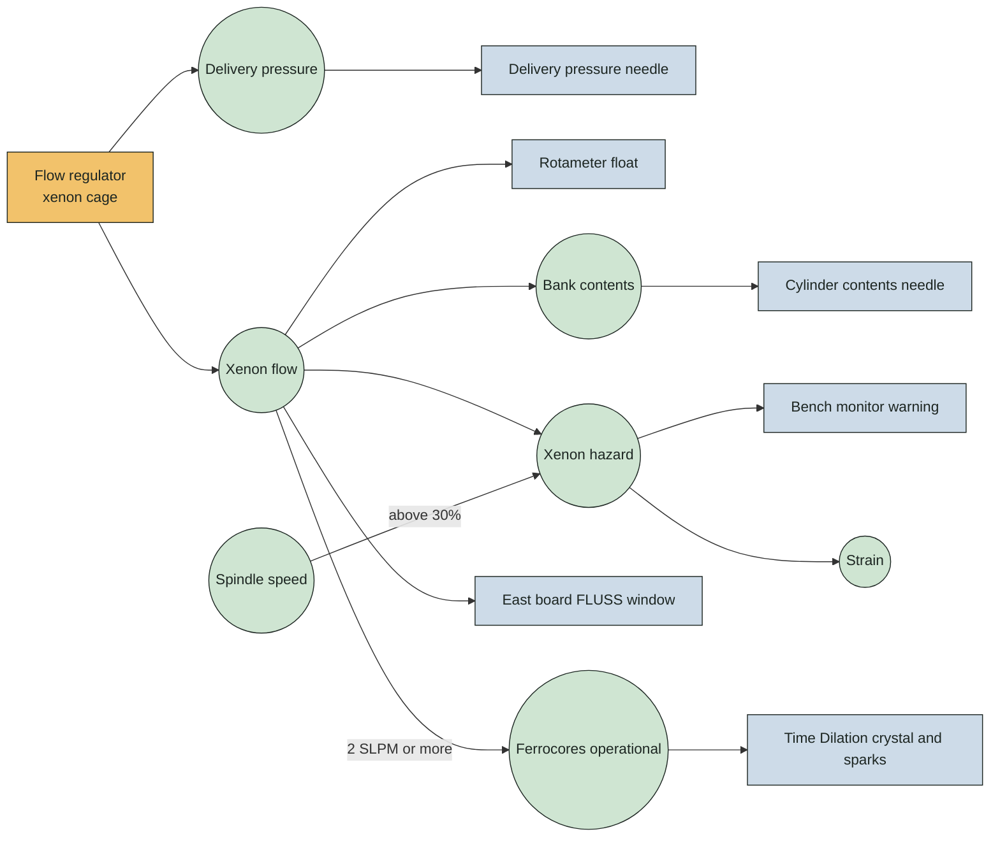
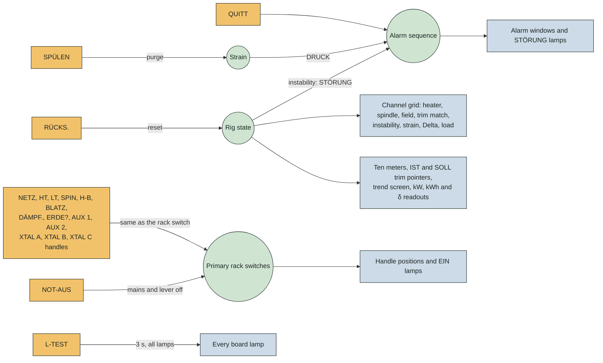

# VX3 control graph

Every operator input in the running game, the machine state it sets, and the indicators that show it, as wired on 12 October 2026. Read each diagram left to right: what a person touches, what the machine does about it, and where you can see the result. Taken from the code in `src/game/rig.ts`, `rack-controls.ts`, `safety-telltales.ts` and `start-scene.ts`.

In each diagram, amber boxes are inputs set by an operator, green circles are machine state and blue boxes are indicators driven by that state.

## Power and drive

The path that gets the ferrocore drum turning. The plant-room master supply must be on before the mains will close; the spindle waits for the valve heaters to pass half temperature.

## Field and stability

The field needs a spindle above a fifth of full speed. Instability is the gap between BLATZ TRIM and where the field wants it, which moves with spindle, field, drift and the spindle gearing (RATIO). GND? earths the plasma inducer and slows the drift. Strain builds while instability is high, or while the xenon circuit is unsafe, and bleeds away fastest when the insulation BAND matches the field; at full strain an incident trips the mains. Time only dilates while the ferrocores are fully operational.

## Monitors and valve banks

Each monitor panel has its own gain and its own BLATZ switch, which puts the field on that panel's trace. The side cabinet's betaform stage gain feeds both monitors, switches stages in (one lamp each, once the heaters reach it) and draws power. Each valve glows from its own switch, scaled by the heaters and HT.

## Xenon supply and bench monitor

Xenon is needed for safe running but never stops a start. Past 30% spindle on less than 2 SLPM, the bench monitor flashes a warning and strain creeps up.

## East board

The 1986 remote station. Its handles work the primary rack switches directly; the second panel of each pair keeps its own switches. Everything else on the board repeats machine state.

## Spare inputs

Every input fitted to this rack now changes the machine. Two alternate panels in the catalogue are not fitted: SERVICE-A's BUS BAND selector holds its own value but reaches nothing, and SUPPLY-A duplicates SUPPLY-B. The operator log is also printed, line by line, on the teleprinter's endless paper.
