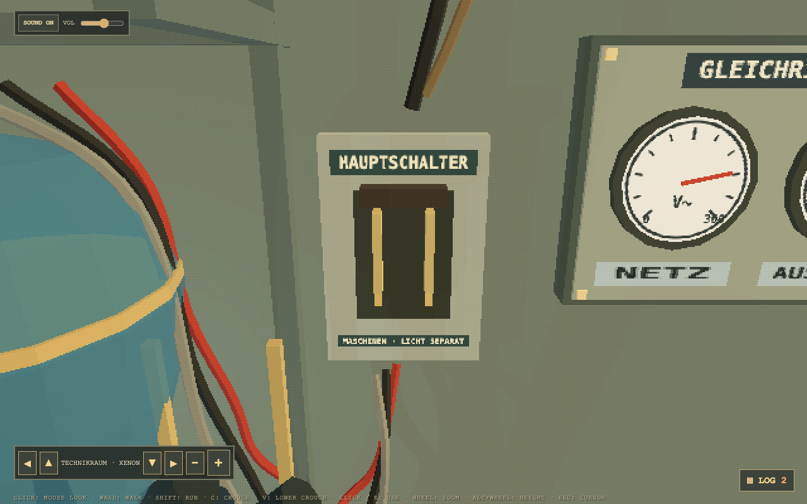
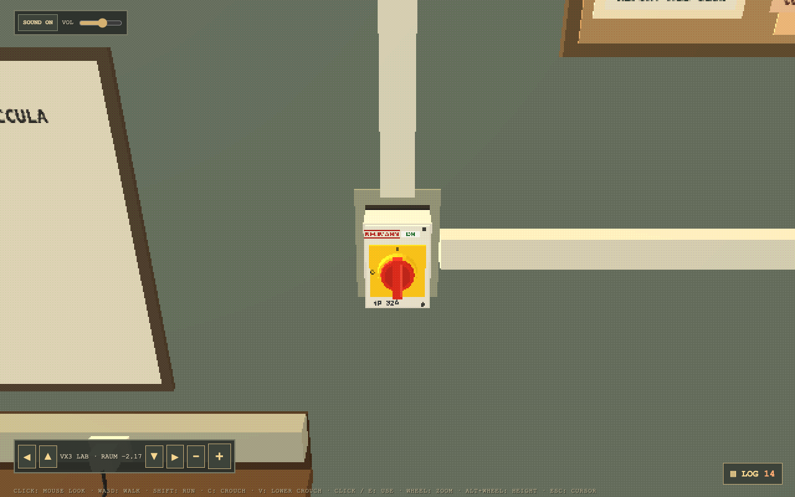
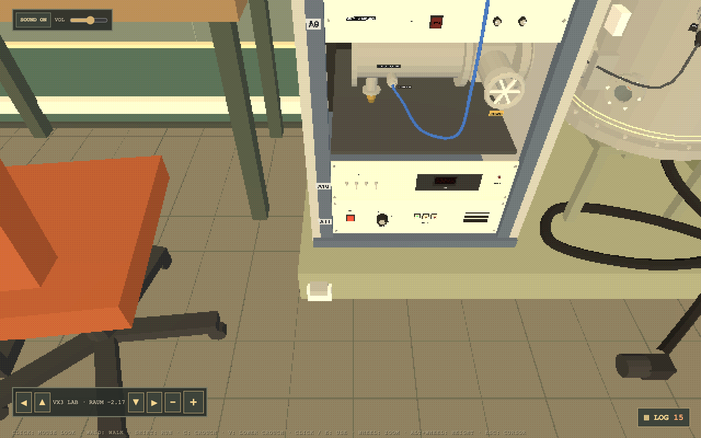
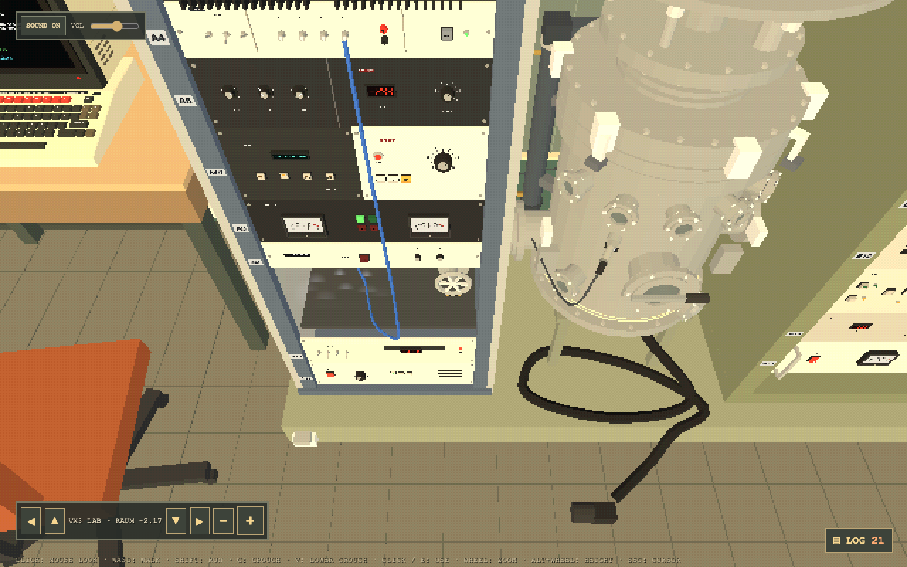
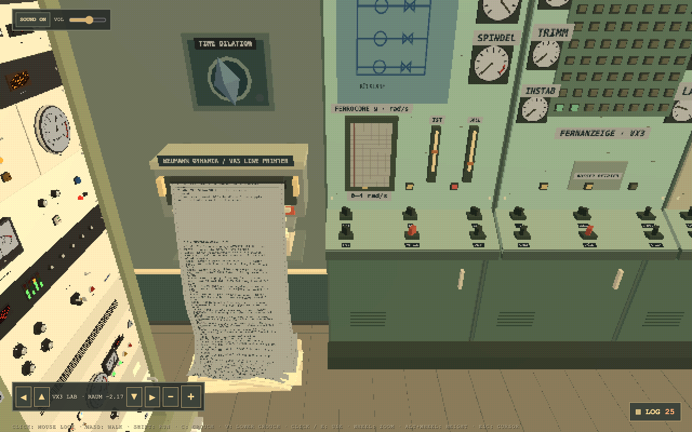
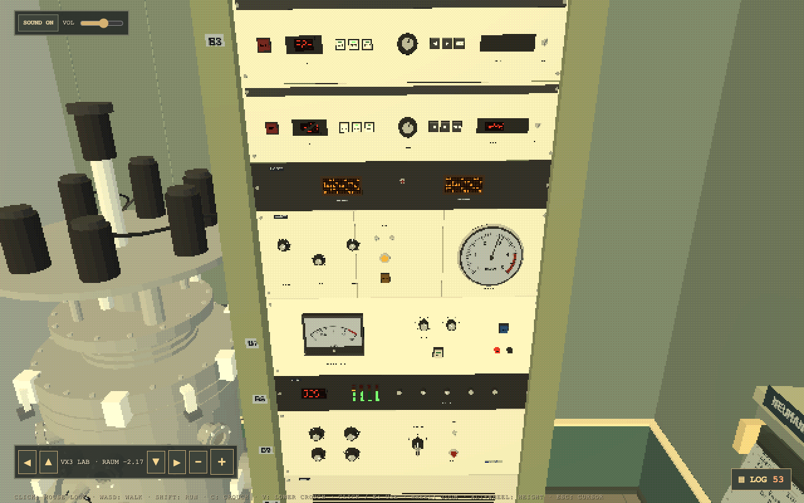
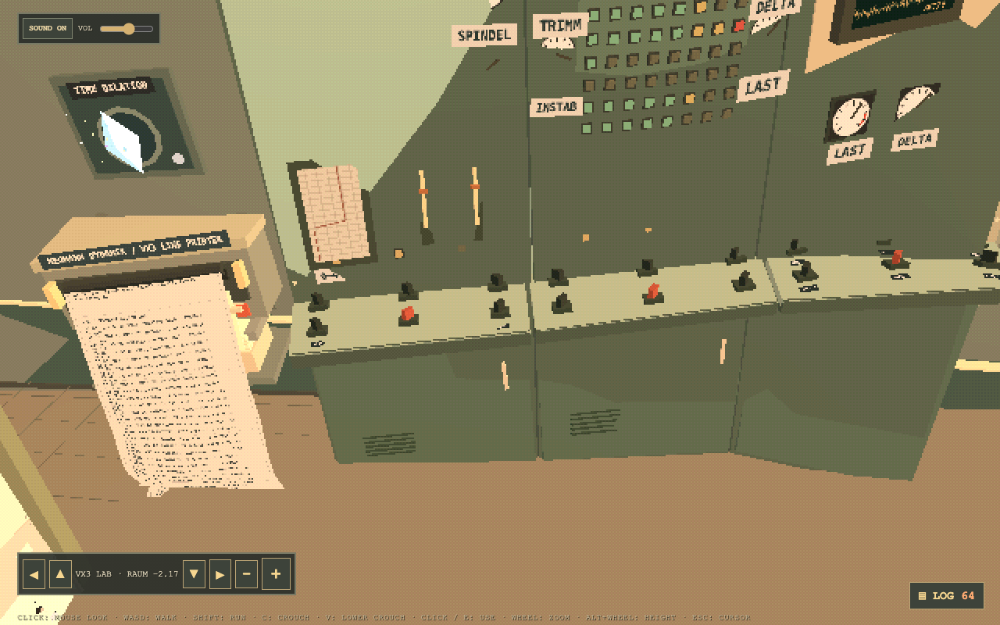
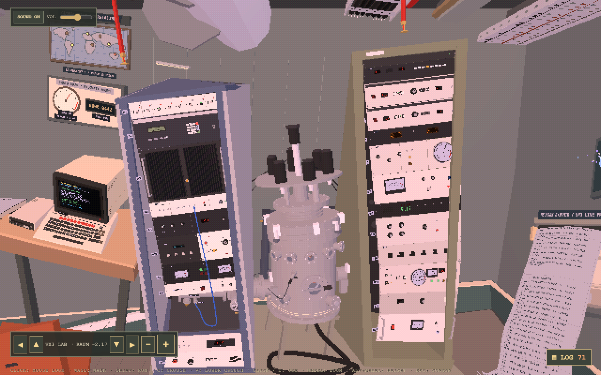

# Runbook: cold start of the VX3

From a dark, cold lab to a ferrocore at full power, using only what a player can see and touch.

The VX3's panels are labelled in German. Each German term is given with its English translation in brackets, and every term is listed in the [glossary](#glossary) at the end.

## How the VX3 is laid out

The VX3 is the whole installation in Room −2.17 and the TECHNIKRAUM (_plant room_) next to it:

- **The plant room (TECHNIKRAUM)**, through the door in the lab's south wall: the HAUPTSCHALTER (_main switch_) and the mercury arc rectifier, which feeds the machine's direct-current equipment; the xenon recirculator, on the mains; and the caged xenon cylinder bank with its flow regulator.
- **The supply isolator**, on the lab's west wall at shoulder height between the Volt Xoccula advertisement and the computer desk, in grey trunking: the machine's main isolator.
- **The machine** in the bay on the north wall: two cabinets on one olive skid with the ferrocore column between them. **Cabinet A** is the grey-blue cabinet on the left, **cabinet B** the tall olive cabinet on the right. Each unit in a cabinet has a number, counted from the top, on a small tag on the cabinet's left upright beside it (A1 to A11, B1 to B13). The column's vessel stands between them; the beam tube runs from it into cabinet A's open bay, with the outlet handwheel on it.
- **The east board**, the 1974 process board on the east wall: the remote station. Its handles switch the drive, and its top row of eighteen alarm windows shows every warning in the installation. Its three bays are KREISLAUF (_circuit_), KANALÜBERSICHT (_channel overview_) and MESSWERTE (_measured values_).

## How the instructions are grouped

- **Power first, from the source inward.** The plant room's supply, then the isolator on the wall, then each cabinet's own supply. Each cabinet has its power in its base: A11 VERSORGUNG (_supply_) and B13 VERSORGUNG (_supply_) are the bottom units.
- **One place at a time.** Each group of steps is worked at one unit (or one board) where you stand, and says which unit and which cabinet it is on.
- **Where to look.** Most steps need you to check something somewhere else: a gauge in another unit, a lamp, or a window on the east board. These are given as **Watch** lines under the step.
- **Names match the log.** Each control is named as the operator's log names it, `machine unit: control`, so a run can be checked against the log. Room fittings (lights, doors, the cage gate) are not logged.

Knob settings are on the knobs' 0 to 10 scale. Every knob turns down one detent when clicked on its left half and up on its right half.

## The rules the machine follows

- The drive's valve heaters and the ferrocore run only in a purged xenon atmosphere: the vessel's head down and clamped, the oxygen purged out, the xenon at working pressure (1.2 bar or more), and the recirculator running. Until then the drive is interlocked, whatever its switches say.
- Xenon reaches the machine only while the recirculator runs.
- The cabinets' equipment runs on direct current from the mercury arc rectifier: with the HAUPTSCHALTER (_main switch_) open, the cabinets are dead. The east board and the lights are on the mains.
- The core's temperature is not set by hand: the warm heaters bring it to a glow (about 1,300 K), and the drive's spindle and field take it on to full power (3,200 K and above).
- Heating the core in an open or unpurged chamber burns it out. Running a hot core with its xenon starved ends in a flux inductance catastrophe.

## 1. Lights

At the lab door, switch on the lab lights (the switch beside the door). Go through the south door into the TECHNIKRAUM (_plant room_) and switch on its lights too.

## 2. The plant room

Stand at the rectifier's wall in the TECHNIKRAUM (_plant room_).

1. `Plant-room supply: HAUPTSCHALTER` (_main switch_): close the master throw switch.
   - **Watch:** the rectifier strikes and glows; its NETZ (_mains_) and AUSGANG (_output_) gauges beside the switch rise. On the east board, the NETZ AUS (_mains off_) window goes out.

2. `Xenon recirculator: KREISLAUF switch` (_circuit switch_): switch the recirculator on, at its housing.
   - **Watch:** its BETRIEB (_running_) lamp lights. On the east board, the UMWÄLZUNG (_recirculation_) window stays dark.

3. Open the xenon cage gate, then `Xenon supply: Flow regulator`: turn the regulator on the cylinder bank up until the rotameter reads at least 2 SLPM (standard litres per minute).
   - **Watch:** the rotameter's float. On the east board, XE FLUSS (_xenon flow_) stays dark once the drive is on.

## 3. The machine's supply

Each of these starts switched off.

1. `VX3 HAUPTTRENNER: supply isolator` (_main isolator_), on the lab's west wall: turn it on. The handle swings upright to point at I, and its window reads ON.

2. `VX3 A11 VERSORGUNG: NETZ button` (_supply unit: mains button_), in the base of cabinet A: press the red NETZ (_mains_) button. It lights.

3. `VX3 B13 VERSORGUNG: cabinet supply rocker` (_supply unit_), in the base of cabinet B: switch the rocker on.
   - **Watch:** B13's NETZSPANNUNG (_mains voltage_) voltmeter reads. Cabinet B's readouts and lamps come alive.

## 4. Seal the vessel

Stand at B11 SÄULE (_column_), cabinet B's column station, low in the cabinet: crouch (C) to work it comfortably. It carries the KAMMERDRUCK (_chamber pressure_) gauge, the LAMBDA-SONDE (_lambda probe_, the oxygen sensor) meter and the DICHT (_sealed_), DRUCK (_pressure_) and STÖRUNG (_fault_) lamps.

1. `VX3 B11 SÄULE: SENKEN button` (_column: lower_): the rams lower the head and the core into the vessel, about six seconds.
   - **Watch:** the UNTEN (_down_) lamp on B11 blinks while the head moves and burns steady when it is down; the seam between the flanges puffs as they meet. (The OBEN lamp beside it means _up_.)
2. `VX3 B11 SÄULE: SPANNEN button` (_clamp_): the four clamps close.
   - **Watch:** SPANNEN's lamp and DICHT (_sealed_) on B11 light. On the east board, KOPF OFFEN (_head open_) stays dark.
3. `VX3 B11 SÄULE: XE EIN button` (_xenon in_): open the xenon inlet. Its blue lamp lights.

## 5. Purge and pressurise

1. `VX3 STRAHLROHR: outlet valve` (_beam tube_): turn the handwheel on the beam tube, between the vessel and cabinet A's open bay, to open the outlet to the pump. (`East board: SPÜLEN handle` (_purge_) does the same from the board.)
   - **Watch:** AUSLASS (_outlet_) on B11 lights.

2. Wait about twenty seconds while the xenon flows in and the air is pumped out, until the oxygen is below 0.5 %.
   - **Watch:** on B11, the LAMBDA-SONDE (_lambda probe_) needle climbs into the green band and the O2 = 0 (_no oxygen_) lamp lights.

3. `VX3 STRAHLROHR: outlet valve` (_beam tube_) again: shut the outlet.
   - **Watch:** the KAMMERDRUCK (_chamber pressure_) gauge on B11 climbs past 1.2 bar towards the regulator's 1.8 bar in about ten seconds.

## 6. Start the drive

Stand at the east board.

1. `East board: NETZ handle` (_mains_), the first handle of the KREISLAUF (_circuit_) bay: close the drive's breaker. It refuses, with a line in the log, if the HAUPTSCHALTER (_main switch_) is open or the machine is switched off at the isolator, A11 or B13.
   - **Watch:** the top row of alarm windows. If anything above was missed, HEIZ. GESP. (_heating locked out_) lights with the window for what is missing: KOPF OFFEN (_head open_), O2 KESSEL (_oxygen in the vessel_), XE DRUCK (_xenon pressure_), XE FLUSS (_xenon flow_) or UMWÄLZUNG (_recirculation_). Otherwise the valve heaters warm by themselves in about six seconds: the HEIZUNG (_heating_) meter rises, the log says when they are at temperature, and the core glows orange (about 1,300 K on B12 KERN's (_core's_) IST K (_actual, kelvin_) readout).

## 7. Bring the ferrocore up

Stand at B6 ANTRIEB (_drive_), cabinet B's drive unit at shoulder height, with the big round gauge.

1. `VX3 B6 ANTRIEB: DREHZAHL knob` (_drive: speed_): spindle speed up to about 7. Keep it under 8.5, the SPINDEL (_spindle_) red line.
2. `VX3 B6 ANTRIEB: FELD knob` (_field_): the Helmholtz-Blatz field up to about 7, under 8.5, the FELD (_field_) red line. The field needs a turning spindle.

3. `VX3 B6 ANTRIEB: TRIMM knob` (_trim_): trim the field.
   - **Watch:** the east board's IST (_actual_) and SOLL (_set point_) pointers, in the KREISLAUF (_circuit_) bay: bring IST (the trim) up to SOLL (where the field balances). At DREHZAHL (_speed_) 7 and FELD (_field_) 7 that is about 6.5. The trim point wanders as the field drifts, so keep tending it. A good trim locks the field (the log says "H-B field locked") and keeps INSTAB (_instability_) down.

4. As the drive's activity rises, the core goes from orange through white-hot to blue, pulses and spins: full power. The room reacts: colours breathe, π wanders, the walls bend, and the time-dilation crystal over the teleprinter glows and sheds particles.

## Other controls

- `VX3 B6 ANTRIEB: HT heater switch` and `VX3 B6 ANTRIEB: LT heater switch` (_high-tension and low-tension heaters_), under HV FIL (_heater filaments_), switch the valve heaters in; both start on. `VX3 B6 ANTRIEB: ZÜND button` (_ignition_) brings both in at once.
- `VX3 B12 KERN: UNTERSETZUNG knob` (_core: gearing ratio_) changes the spindle's gearing and moves the trim point: retrim after changing it.
- `VX3 B9 SCHWEBUNG: SCHWEBUNG key` (_beat-frequency key_), then `VX3 B9 SCHWEBUNG: SCHWEBUNG band selector`, which is key-locked and marked "nur mit Freigabe" (_only with authorisation_), sets the insulation band, which clears strain fastest when it matches the field.
- `VX3 A7 XE-REGLER: XE-REGLER + key` and `XE-REGLER − key` (_xenon regulator_) step the plant room's xenon regulator from the machine.
- The east board's other handles work the drive's switches: HT and LT (_high and low tension_), SPIN, H-B (_Helmholtz-Blatz field_), BLATZ, DÄMPF. (_damping_), ERDE? (_earth?_), AUX (_auxiliary_) and XTAL (_crystal_). SPIN and H-B must be up for the spindle and field to respond.

## Shut down

1. `East board: NETZ handle` (_mains_): open the drive's breaker. The heaters and drive run down and the core cools.
2. In a hurry, any of these trips the breaker: `East board: NOT-AUS handle` (_emergency stop_), `VX3 A9 STRAHL: STRAHL STOP button` (_beam stop_), `VX3 B3 VERDAMPFER 1: VERDAMPFER 1 AUS button` or `VX3 B4 VERDAMPFER 2: VERDAMPFER 2 AUS button` (_evaporator 1 or 2 off_).
3. Once the core is cold, `VX3 B11 SÄULE: XE EIN button` (_xenon in_) to shut the inlet. Leave the vessel sealed, or release `VX3 B11 SÄULE: SPANNEN button` (_clamp_) and raise the head with `VX3 B11 SÄULE: HEBEN button` (_raise_).

## Faults and recovery

| What happened                               | What you see                                                                                                                                                     | What to do                                                                                                                                                 |
| ------------------------------------------- | ---------------------------------------------------------------------------------------------------------------------------------------------------------------- | ---------------------------------------------------------------------------------------------------------------------------------------------------------- |
| Core heating in an open or unpurged vessel  | East board KERN LUFT (_core in air_); B11's STÖRUNG (_fault_) lamp flashing; a log warning                                                                       | Trip the drive at once (NETZ (_mains_) or NOT-AUS (_emergency stop_)) and finish sealing and purging                                                       |
| Burnout (the core heated in air)            | East board KERN DEFEKT (_core failed_); B11's STÖRUNG (_fault_) lamp; the drive trips with a bang                                                                | `VX3 B11 SÄULE: QUITT button` (_acknowledge_) or `East board: RÜCKS. handle` (_reset_) fits a fresh core and tops up the xenon; start again from section 4 |
| Xenon starved (flux inductance catastrophe) | East board XE DRUCK (_xenon pressure_), then KERN DEFEKT (_core failed_); B11's DRUCK (_pressure_) lamp                                                          | As burnout; check the recirculator and the regulator first                                                                                                 |
| Strain builds until the drive trips         | East board DEHNUNG (_strain_), INSTAB (_instability_), STÖRUNG (_fault_); a fault printout with clues                                                            | Retrim, bring DREHZAHL (_speed_) or FELD (_field_) down, use the insulation band; acknowledge with `East board: QUITT handle` (_acknowledge_)              |
| Over the red lines                          | East board SPINDEL ROT (_spindle in the red_), FELD ROT (_field in the red_), LAST (_load_); the machine smokes, RAUCH (_smoke_); the fire alarm, BRAND (_fire_) | Bring DREHZAHL (_speed_) and FELD (_field_) down; the fire alarm is reset at the corridor panel                                                            |
| The cabinets are dead                       | No lamps or readouts in cabinets A and B; powered buttons log "no supply"                                                                                        | Close the HAUPTSCHALTER (_main switch_); check the isolator, A11 and B13                                                                                   |

`East board: QUITT handle` (_acknowledge_) acknowledges the flashing windows: an acknowledged window burns steady until its cause clears, and one that cleared before anyone acknowledged it keeps flashing until QUITT. `East board: L-TEST handle` (_lamp test_) flashes every lamp on the board together for ten seconds.

## The east board's alarm windows

| Bay                                 | Window      | In English           | Lit when                                                        |
| ----------------------------------- | ----------- | -------------------- | --------------------------------------------------------------- |
| KREISLAUF (_circuit_)               | NETZ AUS    | Mains off            | The HAUPTSCHALTER (_main switch_) is open                       |
|                                     | HEIZ. GESP. | Heating locked out   | NETZ is on but the heaters are interlocked                      |
|                                     | SPINDEL ROT | Spindle in the red   | Spindle over its red line                                       |
|                                     | FELD ROT    | Field in the red     | Field over its red line                                         |
|                                     | LAST        | Load                 | Load over 6.5 kW                                                |
|                                     | STÖRUNG     | Fault                | Drive incident, or instability with the drive on                |
| KANALÜBERSICHT (_channel overview_) | KOPF OFFEN  | Head open            | NETZ on and the head not down and clamped                       |
|                                     | O2 KESSEL   | Oxygen in the vessel | NETZ on, vessel sealed, oxygen not yet purged                   |
|                                     | XE DRUCK    | Xenon pressure       | NETZ on, vessel sealed, xenon under working pressure or starved |
|                                     | XE VORRAT   | Xenon reserve        | The vessel's xenon buffer under a quarter                       |
|                                     | KERN LUFT   | Core in air          | Core warming in an open or unpurged vessel                      |
|                                     | KERN DEFEKT | Core failed          | Core failed                                                     |
| MESSWERTE (_measured values_)       | XE FLUSS    | Xenon flow           | NETZ on and under 2 SLPM reaching the machine                   |
|                                     | UMWÄLZUNG   | Recirculation        | NETZ on and the recirculator not running                        |
|                                     | DEHNUNG     | Strain               | Strain over half                                                |
|                                     | INSTAB      | Instability          | Instability over the warning level                              |
|                                     | RAUCH       | Smoke                | The machine is smoking                                          |
|                                     | BRAND       | Fire                 | The fire alarm is sounding                                      |

## The units of cabinets A and B

| Unit       | Name                | In English                | What it is for in a cold start                                             |
| ---------- | ------------------- | ------------------------- | -------------------------------------------------------------------------- |
| A1         | KANÄLE              | Channels                  | —                                                                          |
| A2         | FC-STEUERUNG        | Ferrocore control         | —                                                                          |
| A3         | ENDSTUFE            | Power amplifier           | —                                                                          |
| A4         | SPULEN              | Coils                     | —                                                                          |
| A5         | HV KATODE           | High-voltage cathode      | —                                                                          |
| A6, A7     | VARISTOR, XE-REGLER | Varistor, xenon regulator | XE-REGLER − and + step the plant room's regulator                          |
| A8         | STRAHLSTROM         | Beam current              | —                                                                          |
| A9         | STRAHL              | Beam                      | STRAHL STOP (_beam stop_) trips the drive                                  |
| (open bay) |                     |                           | The beam tube enters here                                                  |
| A10        | TIEGELHEIZUNG       | Crucible heating          | —                                                                          |
| A11        | VERSORGUNG          | Supply                    | Cabinet A's supply: NETZ (_mains_) button                                  |
| B1         | KENNUNG             | Identification            | —                                                                          |
| B2         | MESSWERTE           | Measured values           | The core's temperature, the chamber pressure and the xenon left            |
| B3, B4     | VERDAMPFER 1, 2     | Evaporator 1, 2           | AUS (_off_) trips the drive                                                |
| B5         | ANZEIGE             | Display                   | —                                                                          |
| B6         | ANTRIEB             | Drive                     | DREHZAHL (_speed_), FELD (_field_), TRIMM (_trim_); heaters (HV FIL, ZÜND) |
| B7         | KAPAZITÄT           | Capacity                  | —                                                                          |
| B8         | OFFSET              | Offset                    | —                                                                          |
| B9         | SCHWEBUNG           | Beat frequency            | The insulation band (key-locked)                                           |
| B10        | RESERVE             | Spare                     | —                                                                          |
| B11        | SÄULE               | Column                    | The vessel: head, clamps, inlet, pressure, purge, faults                   |
| B12        | KERN                | Core                      | The core's temperature; UNTERSETZUNG (_gearing ratio_)                     |
| B13        | VERSORGUNG          | Supply                    | Cabinet B's supply: the rocker                                             |

## Glossary

| German                         | English                                    |
| ------------------------------ | ------------------------------------------ |
| ANTRIEB                        | Drive                                      |
| ANZEIGE                        | Display                                    |
| AUS                            | Off                                        |
| AUSGANG                        | Output                                     |
| AUSLASS                        | Outlet                                     |
| BETRIEB                        | Running, in operation                      |
| BRAND                          | Fire                                       |
| DEHNUNG                        | Strain                                     |
| DICHT                          | Sealed                                     |
| DREHZAHL                       | Speed (revolutions)                        |
| DRUCK                          | Pressure                                   |
| DÄMPF. (DÄMPFUNG)              | Damping                                    |
| EIN                            | On, in                                     |
| ENDSTUFE                       | Power amplifier (output stage)             |
| ERDE?                          | Earth?                                     |
| FC-STEUERUNG                   | Ferrocore control                          |
| FELD                           | Field                                      |
| HAUPTSCHALTER                  | Main switch                                |
| HAUPTTRENNER                   | Main isolator                              |
| HEBEN                          | Raise                                      |
| HEIZ. GESP. (HEIZUNG GESPERRT) | Heating locked out                         |
| HEIZUNG                        | Heating                                    |
| HT, LT                         | High tension, low tension                  |
| HV FIL                         | High-voltage filaments (the valve heaters) |
| HV KATODE                      | High-voltage cathode                       |
| IST                            | Actual (value)                             |
| KAMMERDRUCK                    | Chamber pressure                           |
| KANALÜBERSICHT                 | Channel overview                           |
| KANÄLE                         | Channels                                   |
| KAPAZITÄT                      | Capacity                                   |
| KENNUNG                        | Identification                             |
| KERN                           | Core                                       |
| KERN DEFEKT                    | Core failed                                |
| KERN LUFT                      | Core in air                                |
| KESSEL                         | Vessel                                     |
| KOPF OFFEN                     | Head open                                  |
| KREISLAUF                      | Circuit                                    |
| L-TEST                         | Lamp test                                  |
| LAMBDA-SONDE                   | Lambda probe (oxygen sensor)               |
| LAST                           | Load                                       |
| MESSWERTE                      | Measured values                            |
| NETZ                           | Mains                                      |
| NETZ AUS                       | Mains off                                  |
| NETZSPANNUNG                   | Mains voltage                              |
| NOT-AUS                        | Emergency stop                             |
| nur mit Freigabe               | Only with authorisation                    |
| O2 = 0                         | No oxygen                                  |
| OBEN, UNTEN                    | Up, down                                   |
| QUITT (QUITTIEREN)             | Acknowledge                                |
| RAUCH                          | Smoke                                      |
| RESERVE                        | Spare                                      |
| ROT                            | Red (over the red line)                    |
| RÜCKS. (RÜCKSETZEN)            | Reset                                      |
| SÄULE                          | Column                                     |
| SCHWEBUNG                      | Beat frequency                             |
| SENKEN                         | Lower                                      |
| SOLL                           | Set point (target value)                   |
| SPANNEN                        | Clamp                                      |
| SPINDEL                        | Spindle                                    |
| SPULEN                         | Coils                                      |
| SPÜLEN                         | Purge                                      |
| STÖRUNG                        | Fault                                      |
| STRAHL                         | Beam                                       |
| STRAHLROHR                     | Beam tube                                  |
| STRAHLSTROM                    | Beam current                               |
| TECHNIKRAUM                    | Plant room                                 |
| TIEGELHEIZUNG                  | Crucible heating                           |
| TRIMM                          | Trim                                       |
| UMWÄLZUNG                      | Recirculation                              |
| UNTERSETZUNG                   | Gearing ratio (reduction)                  |
| VERDAMPFER                     | Evaporator                                 |
| VERSORGUNG                     | Supply                                     |
| XE (XENON)                     | Xenon                                      |
| XE EIN                         | Xenon in                                   |
| XE FLUSS                       | Xenon flow                                 |
| XE VORRAT                      | Xenon reserve                              |
| XE-REGLER                      | Xenon regulator                            |
| ZÜND (ZÜNDUNG)                 | Ignition                                   |

## Checking a run

In a development build, `vx3Walker.press('VX3 B11 SÄULE: SENKEN button')` works any control by its log name, `vx3Walker.log()` returns the newest log lines, and `vx3Walker.board().lit` lists the alarm windows not at rest.
